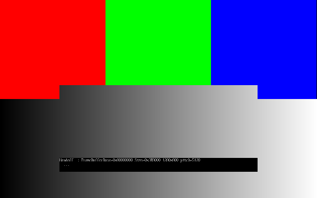

# Вывод на экран в UEFI: GOP, UGA, сравнение с VBE, использование ОС при загрузке

> **О названии в вопросе.** В двух записях формулировки разошлись: «VGE» и «eso graphics extensions».
> Обе читаются как **VESA BIOS Extensions (VBE)** — legacy-путь вывода графики через BIOS, который
> UEFI и заменил. Именно с ним GOP сравнивают, и дальше речь о нём. Отдельного стандарта «VGE»
> не существует, а «eso» — это, судя по всему, «VESA» на слух.

> **Статус проверки.** Всё в этом отчёте запущено: и хостовая модель, и настоящее UEFI-приложение
> на реальной прошивке OVMF под QEMU 8.2.2. Раздел 2 содержит живой вывод и скриншот.

## 1. Какие протоколы вывода есть в UEFI

| Протокол | Уровень | Что даёт | Статус |
|---|---|---|---|
| `EFI_SIMPLE_TEXT_OUTPUT_PROTOCOL` (ConOut) | текст | `OutputString`, курсор, цвета, режимы `QueryMode` в символах | часть UEFI, консоль прошивки |
| **GOP**: `EFI_GRAPHICS_OUTPUT_PROTOCOL` | графика | режимы, `Blt`, **адрес и размер линейного фреймбуфера** | UEFI 2.0+, основной |
| **UGA**: `EFI_UGA_DRAW_PROTOCOL` | графика | `GetMode`/`SetMode`/`Blt`, **без адреса фреймбуфера** | Intel Framework / EFI 1.10, в UEFI-спецификацию не вошёл, заменён GOP |

Оба графических протокола ставятся на handle графического контроллера драйвером (по `EFI_DRIVER_BINDING_PROTOCOL`, например, на PCI-устройство) и находятся через `LocateProtocol`/`HandleProtocol` по GUID.

### Устройство GOP

```
EFI_GRAPHICS_OUTPUT_PROTOCOL
 ├─ QueryMode(This, ModeNumber, &SizeOfInfo, &Info)   перечисление режимов
 ├─ SetMode(This, ModeNumber)                         смена режима
 ├─ Blt(This, BltBuffer, Op, SrcX,SrcY, DstX,DstY, W,H, Delta)
 │     Op: VideoFill | VideoToBltBuffer | BufferToVideo | VideoToVideo
 │     пиксель Blt: {Blue, Green, Red, Reserved}
 └─ Mode ──► EFI_GRAPHICS_OUTPUT_PROTOCOL_MODE
              MaxMode, Mode, Info*, SizeOfInfo,
              FrameBufferBase (физический адрес), FrameBufferSize
              Info ──► Version, HorizontalResolution, VerticalResolution,
                       PixelFormat, PixelInformation{Red,Green,Blue,Reserved маски},
                       PixelsPerScanLine
```

Формат пикселя (`PixelFormat`):
- `RedGreenBlueReserved8BitPerColor`: 32 бита, байты R,G,B,X.
- `BlueGreenRedReserved8BitPerColor`: 32 бита, байты B,G,R,X.
- `PixelBitMask`: раскладка в масках `PixelInformation`.
- `PixelBltOnly`: **прямого доступа к фреймбуферу нет**, только `Blt`.

Главная ловушка: **строка фреймбуфера занимает `PixelsPerScanLine*4` байт, а не `HorizontalResolution*4`**. Из-за выравнивания строка может быть шире экрана.

## 2. Примеры и бенчмарки (`uefi_gfx/`)

| Файл | Что делает | Проверено |
|---|---|---|
| `gop_model.c` | хостовая модель: структуры GOP со `static_assert` на смещения по спецификации, форматы пикселей, ошибка pitch, «handoff» ОС, бенчмарк `Blt` | **запущено** (gcc 14) |
| `gop_app.c`, `Makefile`, `run_qemu.sh` | настоящее UEFI-приложение (gnu-efi): ищет GOP/UGA, перечисляет режимы, рисует через `Blt` и прямой записью во фреймбуфер | **запущено на OVMF под QEMU 8.2.2**, см. раздел 2.1 |
| `fetch_deps.sh` | качает gnu-efi, OVMF, QEMU и seabios и распаковывает локально, **без sudo** | запущено, так всё и собиралось |
| `os_view.sh` | показывает, что видит ОС после загрузки (`/proc/iomem` BOOTFB, `efifb`/`simpledrm`, BGRT) | запущено, но машина не UEFI (WSL2), поэтому вывод пустой |

### Результаты `gop_model` (запуск: `make gop_model && ./gop_model`)

```
Раскладка структур по спецификации: OK   (sizeof(ModeInfo)=36, PixelFormat@12, PixelsPerScanLine@32, Mode: FrameBufferBase@24, size=40)
Handoff для ОС: 1024x768, pitch=4352 байт (width*4=4096)
Красный: RGBX=0x000000FF  BGRX=0x00FF0000  BitMask(маски 0x3FF00000/…)=0x0FF00000
Ошибка pitch (stride=width*4): на место попало 1 из 768 строк, 767 промахов
С правильным pitch (PixelsPerScanLine*4): 768 из 768

Blt BufferToVideo 1024x768 x1500 (RAM-модель)
  BGRX->BGRX, memcpy по строкам : 0.521 s  (9051 МБ/с)
  BGRX->BGRX, попиксельный pack : 1.230 s  (3836 МБ/с, ×2.4 медленнее)
  BGRX->RGBX, обязательно pack  : 1.144 s  (4126 МБ/с)
```

Выводы:
- Раскладка структур, которую ОС и загрузчики читают по бинарному ABI, совпадает со спецификацией.
- Разница форматов существенна: один и тот же красный это `0x000000FF` или `0x00FF0000`. Нужно смотреть `PixelFormat` или маски.
- Ошибка в pitch ломает картинку почти целиком.
- Совпадение формата фреймбуфера с форматом `Blt` даёт `memcpy` вместо конвертации, это ×2.4 в модели.

**Ограничение:** это оперативная память, не MMIO видеокарты. На реальном устройстве фреймбуфер обычно отображён как write-combining (WC) или даже uncached. Запись идёт быстро (пакетами), а **чтение из фреймбуфера очень медленное**. Поэтому `VideoToVideo`/скролл через чтение и «рисовать в теневой буфер в RAM и копировать целиком» разумнее, чем читать пиксели обратно. Величину разрыва я здесь не измерял.

## 2.1. Запуск настоящего UEFI-приложения на OVMF

Сборка и запуск (пакеты ставятся локально, sudo не нужен):
```sh
./fetch_deps.sh
make GNUEFI=$PWD/deps/root/usr
./run_qemu.sh
```
Получается настоящий PE32+: `gop_app.efi: PE32+ executable (EFI application) x86-64, 6 sections`.
Он кладётся в `esp/EFI/BOOT/BOOTX64.EFI`, QEMU отдаёт этот каталог как FAT-раздел, OVMF его находит
и запускает. Вывод забирается из последовательного порта, экран снимается через монитор QEMU.

### Живой вывод

```
BdsDxe: starting Boot0001 "UEFI QEMU HARDDISK QM00001 " from PciRoot(0x0)/Pci(0x1F,0x2)/Sata(0x0,0xFFFF,0x0)
UGA: нет
GOP: MaxMode=30 текущий=0
 режим  0: 1280x800 pitch(px)=1280 формат=BGRX8  <-- текущий
 режим  1: 640x480 pitch(px)=640 формат=BGRX8
 режим  7: 1024x768 pitch(px)=1024 формат=BGRX8
 ...
 режим 29: 2560x1600 pitch(px)=2560 формат=BGRX8

Handoff для ОС: FrameBufferBase=0x80000000 Size=0x3E8000 1280x800 pitch=5120 байт
```

Что из этого реально подтвердилось:

1. **UGA в современной прошивке отсутствует.** `LocateProtocol` по GUID UGA вернул ошибку. OVMF 2024.02
   его не предоставляет вовсе. Это прямое подтверждение того, что UGA вытеснен полностью: писать
   загрузчик под него сегодня не на чем.
2. **GOP отдал 30 режимов**, от 640x480 до 2560x1600, все в формате `BGRX8`
   (`PixelBlueGreenRedReserved8BitPerColor`). Ни одного `PixelBltOnly` на этом устройстве нет,
   то есть прямой доступ к фреймбуферу доступен во всех режимах.
3. **Фреймбуфер по физическому адресу `0x80000000`**, размер `0x3E8000` = 4 096 000 байт.
   Проверка: 1280 x 800 x 4 = 4 096 000, сходится. Это адрес MMIO-окна видеокарты на шине PCI,
   и именно его прошивка передаёт операционной системе.
4. **`pitch = 5120 = 1280 x 4`**, то есть `PixelsPerScanLine` совпал с шириной.
   Честная оговорка: предупреждение из раздела 2 про «строка может быть шире экрана» на
   QEMU std VGA **не проявилось** — здесь они равны во всех 30 режимах. Различаются они
   на реальном железе, где строка выравнивается под требования контроллера. Брать
   `PixelsPerScanLine` всё равно обязательно, но продемонстрировать расхождение удалось
   только в хостовой модели (`gop_model`), а не на живой прошивке.

### Скриншот



На экране одновременно работают оба способа рисования:

- **верхняя половина** — три полосы через `Blt` с операцией `EfiBltVideoFill`
  (это службы загрузки, они доступны только до `ExitBootServices`);
- **нижняя половина** — серый градиент **прямой записью** в `FrameBufferBase`
  с шагом `PixelsPerScanLine * 4`. Именно так рисует ядро ОС, когда `Blt` уже недоступен;
- **чёрная плашка с текстом** посередине — текстовая консоль прошивки (`ConOut`), которая
  вывела строку про handoff. Хорошо видно, что `ConOut` и GOP делят один и тот же фреймбуфер
  и рисуют друг поверх друга.

Проверка пикселей скриншота подтверждает корректность обоих путей:
```
Полосы через Blt, y=200:       x=200 -> RGB(255,0,0)   x=640 -> RGB(0,255,0)   x=1050 -> RGB(0,0,255)
Градиент прямой записью, y=600: x=0 -> 0   x=320 -> 63   x=640 -> 127   x=960 -> 191   x=1279 -> 254
Граница ровно на y=400 (h/2)
```
Цвета чистые, значит порядок байт в `BGRX8` разобран правильно; градиент линейный, значит
шаг строки взят верно.

## 3. GOP против VBE

| Критерий | VBE (BIOS, INT 10h AX=4Fxx) | GOP (UEFI) |
|---|---|---|
| Вызов | прерывание в **real mode** (или V86, эмулятор x86 вроде `v86d`/`x86emu`) | обычный вызов функции в 64-битном режиме |
| Архитектура | только x86 | x86, ARM64, RISC-V и др.: нет привязки к x86-инструкциям |
| Режимы | номер режима + `4F01h` (структура ModeInfoBlock), сетка режимов ограничена таблицей VBE | `QueryMode` по индексу, разрешения прошивка формирует по EDID/драйверу |
| Линейный фреймбуфер | с VBE 2.0 (1994), бит 14 при `4F02h` | адрес и размер сразу в `Mode->FrameBufferBase/Size` |
| Формат пикселя | описывается через RedMaskSize/FieldPosition | `PixelFormat` или маски |
| Драйверная модель | Option ROM с 16-битным кодом на карте | Option ROM на EFI (PE, 64-бит) + `EFI_DRIVER_BINDING_PROTOCOL` |
| Абстракция рисования | нет, только «поставить режим, получить адрес» | есть `Blt` (в т.ч. для `BltOnly`-устройств, у которых фреймбуфер не виден CPU) |
| Работа из ОС после старта | возможна (в V86/эмуляции), но ломается в long mode | **пропадает** после `ExitBootServices` (см. ниже) |
| Развитие | последняя версия VBE 3.0 (1998), не развивается | часть UEFI |

Кроме того, **GOP лучше UGA**: GOP отдаёт физический адрес фреймбуфера и описывает формат пикселя, а UGA даёт только `Blt`, и ОС нечем рисовать напрямую. Это ключевой аргумент для загрузчиков и ранней консоли ядра.

**Обратная сторона GOP:** режим нельзя сменить после `ExitBootServices`. VBE в BIOS-эпоху позволял это делать (через V86) из драйверов вроде `uvesafb`. В UEFI смену режима после загрузки делает уже нативный драйвер GPU (i915, amdgpu, nouveau и др.).

## 4. Как ОС использует эти артефакты на стадии загрузки

```
Прошивка (DXE) ─► драйвер GPU ставит GOP ─► показывает логотип (BGRT в ACPI)
      │
Загрузчик (GRUB / systemd-boot / bootmgfw / rEFInd)
      │  LocateProtocol(GOP), выбор режима (SetMode), чтение Mode->Info
      ▼
 передача ОС «handoff»: base, size, width, height, pitch, формат/маски
      │  ExitBootServices()  ─► Blt/SetMode исчезают, ФРЕЙМБУФЕР остаётся
      ▼
 Ядро: пишет прямо в физический адрес (efifb/simpledrm/…), маппит как WC
      ▼
 нативный DRM-драйвер видеокарты «забирает» экран (aperture remove), фреймбуфер прошивки освобождается
```

Конкретно:

1. **Выбор режима и передача параметров.**
   - Linux с EFI stub (`drivers/firmware/efi/libstub/gop.c`) сам ищет GOP, выбирает режим и заполняет `struct screen_info`: `orig_video_isVGA = VIDEO_TYPE_EFI`, `lfb_base`, `lfb_size`, `lfb_width/height`, `lfb_linelength` (= `PixelsPerScanLine * 4`), `red_size/red_pos` и т.д. по `PixelFormat`/маскам.
   - GRUB делает то же (`gfxpayload`), Windows Boot Manager передаёт данные в loader block, для Multiboot2 есть framebuffer tag.
2. **Ранняя графическая консоль ядра.** По этим данным работают `efifb` или `simpledrm`/`sysfb`. Они пишут в фреймбуфер напрямую, потому что после `ExitBootServices` `Blt` недоступен. Отсюда правило про `pitch`. Поддерживаются форматы «32 бита» и «по маскам», а `PixelBltOnly` ядро использовать не может (нет адреса), при нём остаётся текстовый VGA или ничего.
3. **Карта памяти.** Область фреймбуфера в UEFI memory map числится как MMIO. ОС должна её отобразить (Linux: `ioremap_wc`, то есть write-combining), иначе запись будет очень медленной.
4. **Передача экрана нативному драйверу.** Когда загружается `i915`/`amdgpu`, он вызывает механизм aperture (`aperture_remove_conflicting_devices`/`sysfb_disable`), и старый `efifb`/`simpledrm` отключается, чтобы не рисовать в область, которую драйвер теперь программирует сам.
5. **BGRT.** Прошивка кладёт в ACPI-таблицу BGRT указатель на BMP с логотипом и координаты. ОС (Windows, Linux `plymouth` с bgrt-темой) рисует поверх/рядом с ним, чтобы не было «мигания» при переходе от прошивки к ОС.

### Зачем это операционной системе

Вопрос «зачем» здесь не риторический: у ОС есть собственные драйверы видеокарт, гораздо более
мощные. Артефакты GOP нужны ей ровно потому, что **в момент, когда они нужны, своих драйверов
ещё нет**.

1. **Показать хоть что-то в промежутке.** От `ExitBootServices` до инициализации `i915`/`amdgpu`
   проходит от долей секунды до десятков секунд (распаковка ядра, поиск корневой ФС, initramfs,
   загрузка модулей). Всё это время у ядра нет ни одного драйвера дисплея. Без переданного
   фреймбуфера экран остался бы чёрным, а при панике — молчащим.
2. **Показать ошибку, если дальше ничего не заработает.** Это главный сценарий. Если модуль GPU
   не соберётся, не найдётся корневая ФС или ядро упадёт в панику до загрузки драйверов,
   единственный способ показать сообщение — писать в фреймбуфер прошивки. Поэтому `efifb`
   и `simpledrm` регистрируются очень рано и намеренно примитивны: у них нет зависимостей,
   которые могли бы отказать.
3. **Не требовать драйвера вообще.** Переданный фреймбуфер — это «наименьший общий знаменатель»:
   линейный буфер по известному адресу с известным форматом. Он работает на любой видеокарте,
   включая ту, для которой драйвера в ядре нет вовсе. Установочные образы дистрибутивов
   и системы на экзотическом железе живут на нём постоянно.
4. **Не гасить экран при передаче.** Прошивка уже установила режим и что-то нарисовала.
   Если бы ОС начинала с переинициализации видеокарты, пользователь видел бы чёрный экран
   и переключение режима. Продолжая рисовать в тот же буфер, ОС обеспечивает плавный переход,
   а BGRT позволяет ещё и подхватить логотип производителя — это и есть «бесшовная загрузка»,
   которую видно на ноутбуках с Windows.
5. **Избежать разбора железа на раннем этапе.** Определить модель видеокарты, прочитать EDID,
   рассчитать тайминги и запрограммировать контроллер — это большой код, которому нужны
   работающие PCI, прерывания, таймеры и выделение памяти. Прошивка это уже сделала.
   ОС просто пользуется результатом и откладывает всю сложность до момента, когда система
   полностью поднята.

Ровно поэтому GOP ценнее UGA (см. раздел 3): для всех пяти пунктов нужен **адрес фреймбуфера**,
а не функция `Blt`, которая после `ExitBootServices` перестаёт существовать.

### Как посмотреть на реальной машине

`./os_view.sh`. Типичный вывод на UEFI-системе: строки `efifb:`
(`framebuffer at 0x..., mode is 1920x1080x32, linelength=7680, Truecolor: size=8:8:8:8, shift=...`)
в `dmesg` и область `BOOTFB` в `/proc/iomem`. Легко заметить, что это ровно те поля, которые
приложение из раздела 2.1 напечатало как «Handoff для ОС».

Оговорка: в окружении, где готовился отчёт (WSL2), UEFI нет, `/sys/firmware/efi` отсутствует,
и скрипт даёт пустой вывод. Это единственная часть отчёта, которую проверить не удалось.

## 5. Как собрать и запустить

**Если есть root:**
```sh
sudo apt install gnu-efi qemu-system-x86 ovmf
make && ./run_qemu.sh
```

**Если root нет** (так и делалось здесь) — пакеты качаются и распаковываются локально:
```sh
./fetch_deps.sh
make GNUEFI=$PWD/deps/root/usr
./run_qemu.sh
```
`fetch_deps.sh` тянет `gnu-efi`, `ovmf`, `seabios`, `qemu-system-x86` и семь недостающих
библиотек, распаковывает их в `deps/root` и ничего не ставит в систему. `run_qemu.sh`
сам определяет, использовать локальные пакеты или системные, подставляет
`LD_LIBRARY_PATH` и `QEMU_MODULE_DIR`, запускает OVMF, сохраняет вывод в `serial.txt`
и снимает скриншот в `shot.ppm`.

Результат запуска — в разделе 2.1.
